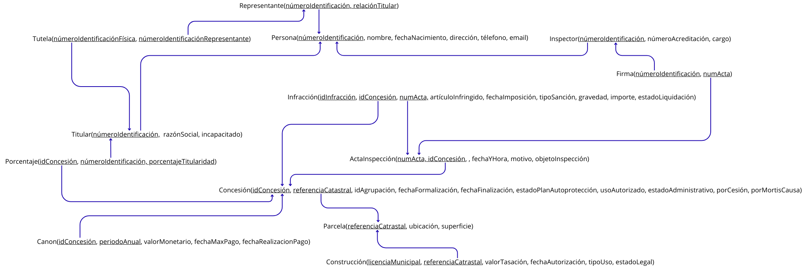
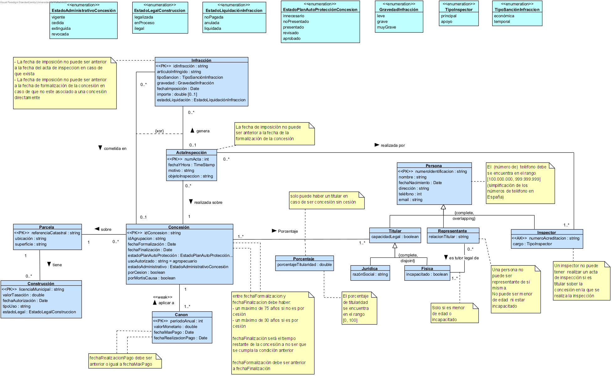
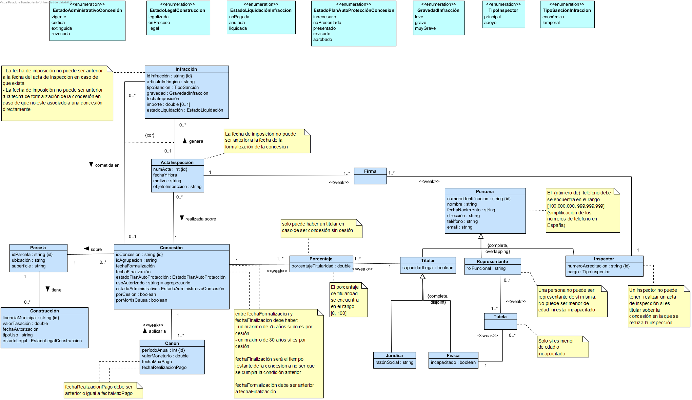

# ADBD-práctica

## Contraseña máquina virtual
G06-eMdA-@2025-ADBD

## Dudas

## ¿Por qué hemos hecho...?
- Quitado sanción: nos hemos percatado de que solamente podría tener dos sanciones diferentes como mucho, una monetaria y otra que sea de reducción de tiempo (que puede hasta quitarte el tiempo)
- Ido por una parcela pertenece a varias concesiones: tiene más sentido para nosotros ver que en un monte de Almonte pasa por distintas concesiones a lo largo del tiempo, y cuando hay un cambio de concesión (normalmente por cuestiones de titularidad) se crea una nueva sobre el mismo terreno.

## Cosas Cambiar:

## Versión Esquema relacional
[canva](https://www.canva.com/design/DAG2so_U9e0/RlmI9PpQsLDTEYu64H_uXw/edit)

## Version ERD

## Versión intermedia ERD 
